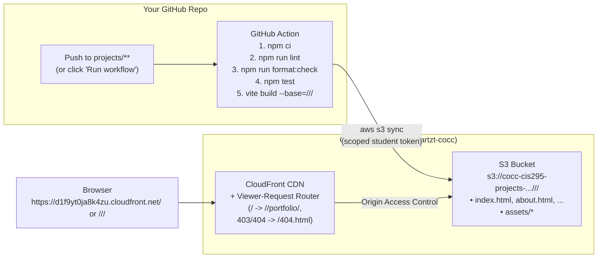

# Student Project Hosting and Deployment

Every project you build under `projects/<project>/` (such as `projects/week1`, `projects/portfolio`,
and `projects/final`) can be deployed automatically to our shared AWS hosting environment. Once
deployed, each project runs at:

```text
https://d1f9yt0ja8k4zu.cloudfront.net/<your-slug>/<project>/
```

For example, if your repository is `jdoe-cocc-web-dev`, your sites are served at:

- `https://d1f9yt0ja8k4zu.cloudfront.net/jdoe` _(redirects automatically to `/jdoe/portfolio/`)_
- `https://d1f9yt0ja8k4zu.cloudfront.net/jdoe/portfolio/` _(starts as a plain HTML index linking all
  weeks, styled into your full Developer Portfolio in Week 10)_
- `https://d1f9yt0ja8k4zu.cloudfront.net/jdoe/week1/` through `/jdoe/week8/`
- `https://d1f9yt0ja8k4zu.cloudfront.net/jdoe/final/`

Visiting a project link that hasn't been deployed yet (such as `/jdoe/final/` early in the term)
shows a friendly **"Not found — coming soon"** `404` page.

## Architecture and Build Workflow



## Running Build Checks Locally Before Pushing

Every project scaffolded with `npm run weekly:create <name>` includes an `npm run check` script that
runs the exact same verification steps as the GitHub Action without modifying any files:

```bash
cd projects/final
npm run check
```

Under the hood, `npm run check` runs four steps in order:

1. `npm run lint` — validates your HTML (`html-validate`) and CSS (`stylelint`)
2. `npm run format:check` — verifies formatting with Prettier (run `npm run format` to fix)
3. `npm test` — runs your Vitest suite once (use `npm run test:watch` while coding)
4. `npm run build` — runs `vite build` across all root `.html` files

## Triggering a Deployment

Once I push your scoped AWS deployment secrets (`AWS_ACCESS_KEY_ID`, `AWS_SECRET_ACCESS_KEY`, and
`STUDENT_SLUG`) to your private GitHub repository, your projects deploy in two ways:

- **Automatically on push:** Any push that changes files inside `projects/<name>/` checks, builds,
  and deploys only the modified project folder(s).
- **Manually from GitHub:** Open your repo on GitHub, go to **Actions -> Deploy Student Projects ->
  Run workflow**, optionally enter a specific project folder (like `final` or `portfolio`), and
  click **Run workflow**.

Open the completed workflow run's **Summary** tab to copy your live CloudFront URL.

## Multi-Page Sites and Relative Links

Because your site lives under `/<your-slug>/<project>/` rather than at the root of the domain:

- Always link between pages using relative paths (`./about.html`, `./contact.html`) rather than
  root-absolute paths (`/about.html`).
- Link from your Developer Portfolio (`/<your-slug>/portfolio/`) to your other deployed course
  projects using sibling relative paths (`../week1/`, `../final/`). Because your portfolio lives in
  its own `projects/portfolio/` folder, you can freely add subfolders, stylesheets, and extra pages
  inside it without ever conflicting with `week1`–`week8` or `final`.
- The CloudFront viewer-request router
  ([`infra/lib/student-hosting-stack.ts`](lib/student-hosting-stack.ts)) redirects `/<your-slug>` to
  `/<your-slug>/portfolio/`, redirects extensionless project directories (like `/jdoe/final`) to
  `/jdoe/final/`, serves `index.html`, and returns `/404.html` ("Not found — coming soon") for
  projects that haven't been deployed yet.

## Exploring the Infrastructure Code

Everything that powers course hosting lives right here in the repository:

- [`.github/workflows/deploy-projects.yml`](../.github/workflows/deploy-projects.yml) — the GitHub
  Action that installs dependencies, runs `lint`, `format:check`, `test`, builds with Vite, and
  syncs each project's `dist/` folder to S3.
- [`infra/lib/student-hosting-stack.ts`](lib/student-hosting-stack.ts) — the AWS CDK stack defining
  the private S3 bucket, CloudFront CDN distribution, `X-Robots-Tag: noindex, nofollow` response
  headers policy, and directory router function.
- [`infra/scripts/issue-student-token.sh`](scripts/issue-student-token.sh) — provisions each
  student's scoped IAM user (`cocc-cis295-student-<slug>`) restricted strictly to
  `s3://.../<slug>/*`.
- [`infra/site/index.html`](site/index.html) and
  [`infra/scripts/deploy-root-index.sh`](scripts/deploy-root-index.sh) — template and script for the
  class directory page listing every student's Final Project and Portfolio.
- [`infra/OPERATIONS.md`](OPERATIONS.md) — instructor operations runbook.

None of the course sites are indexed by search engines: CloudFront attaches an
`X-Robots-Tag: noindex, nofollow` header to every response.
